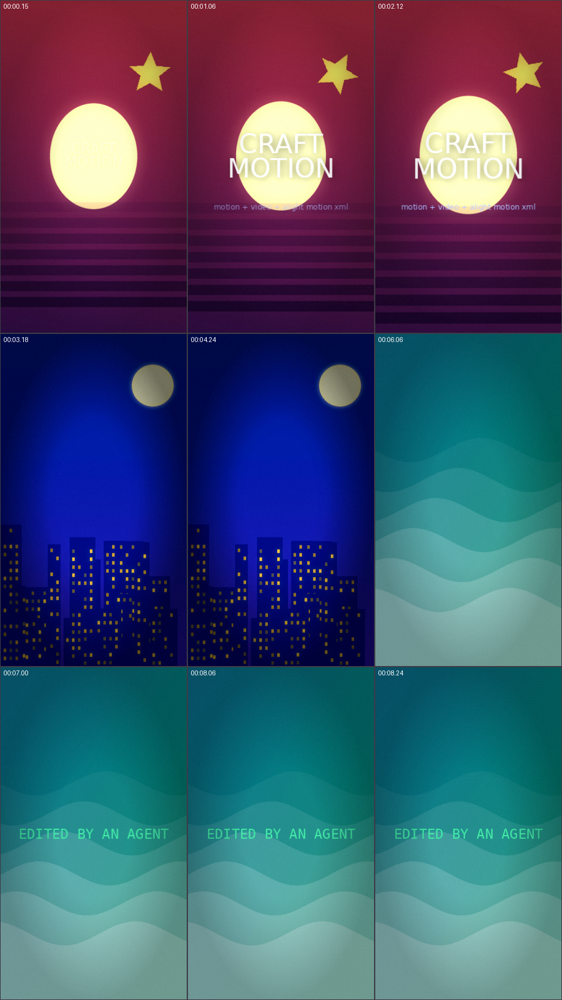
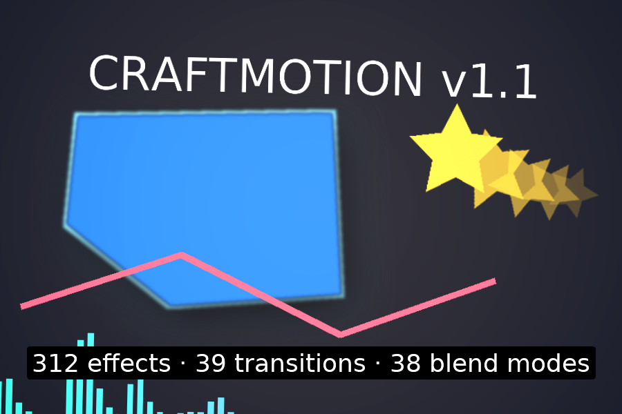

# CraftMotion Studio

**Motion graphics + video editing + Alight Motion XML — one app, two modes.**

CraftMotion combines the panel-and-keyframe workflow of
[EffectCraft](https://github.com/storytold/effectcraft) (open-source After
Effects alternative) with the timeline/colour/audio workflow of
[FilmCraft](https://github.com/storytold/filmcraft) (open-source Premiere Pro
alternative), and adds Alight Motion XML import/export.

It runs in two modes that share **one engine and one complete toolset**:

| Mode | Who uses it | Interface |
|---|---|---|
| **Human mode** | anyone | full desktop GUI (timeline, inspector, program monitor) |
| **Agent mode** | AI agents | **MCP server** — stdio *and* a live HTTP bridge |

Both modes call the same **130-command registry** with **317 effects**, **39
transitions**, **38 blend modes**, masks, layer styles, text animators, a 2.5D
camera, precomps, motion blur, audio-reactive animation, colour grading with
scopes, captions, tracking, Lottie and AM XML — so an agent can do **everything**
a human can, including into the window a human is currently looking at (live
bridge).





### What's new in v1.1

* 317 effects (was 62) · 39 transitions (was 30) · 38 blend modes · 130 commands
* masks with feather/expansion + 7 layer styles · text animators & 6 keyframed
  text presets · trim paths & repeaters
* precomps, 2.5D camera + lights, motion blur, linear-light compositing
* expressions, graph editor (value **and** velocity), Lottie in/out
* colour grade + histogram/waveform/vectorscope, LUTs, HDR/log
* EBU R128 loudness, mixer automation, beats/spectrum analysis and
  **audio-reactive effects** (`audio.analyser`, `audio.react`)
* captions (SRT/VTT), NCC point tracking, three-point editing with J/K/L

Regenerate the showcase above with `python samples/demo_v11.py`.

---

## 1. Get the app

### Windows `.exe` / `.msi`

The packaged build is produced by the included GitHub Actions workflow
(`.github/workflows/build-windows.yml`) on a `windows-latest` runner:

```powershell
pip install numpy pillow imageio-ffmpeg pyinstaller pytest
pytest tests -q
pyinstaller craftmotion.spec --noconfirm      # → dist\CraftMotion.exe
candle -dVersion=1.1.0 installer\craftmotion.wxs
light  installer\craftmotion.wixobj -out dist\CraftMotion-1.1.0-x64.msi
```

Push a tag (`v1.1.0`), push to `main`, or run the workflow manually
(**Actions → Build Windows app → Run workflow**), then download the
**CraftMotion-Windows** artifact:

* `CraftMotion.exe` — portable, one file, ffmpeg bundled (this is the deliverable)
* `CraftMotion-1.1.0-x64.msi` — installer with Start-menu + desktop shortcuts
  (a separate **CraftMotion-MSI** artifact, built best-effort so a WiX problem
  can never cost you the `.exe`)

The workflow runs the test suite first — if `pytest` fails, no artifacts are
produced, so keep `tests/` green before pushing.

> `CraftMotion.exe` is a single-file bundle: double-click → GUI.
> It also answers `mcp`, `serve`, `run`, `batch`, `export`, `storyboard`, `doctor`.

### From source (any OS)

```bash
pip install numpy pillow imageio-ffmpeg
python -m craftmotion            # GUI
python -m craftmotion doctor     # environment check
```

---

## 2. Human mode — what you get

* **Timeline** — drag clips, trim edges, snap, zoom (wheel), markers, per-layer
  keyframe diamonds, split at playhead, duplicate, group under a null.
* **Program monitor** — threaded live preview; drag a layer to move it,
  Ctrl-drag to scale, Alt-drag to rotate.
* **Inspector** — every transform property with a ◆ keyframe toggle, text/shape
  editors, blend modes, timing, media fit/speed, audio volume + fades.
* **Effects** — **317 effects** in 14 categories (colour 119, stylise 38,
  distort 37, generate 24, light 21, blur 19, keying 11, glitch 10, blend 10,
  particles 9, transition 6, sharpen 5, audio 4, time 4), every parameter
  keyframeable, searchable browser panel, plus one-click looks and saved stacks.
* **Blending** — **38 blend modes** (all 27 separable + hue/saturation/colour/
  luminosity + the extended set: phoenix, reflect, glow, freeze, heat, stamp,
  xor, grain extract/merge).
* **Compositing** — precompositions (nested comps with fit modes), track mattes,
  parenting, adjustment layers, linear-light mode and motion blur with a
  configurable shutter (2–16 samples).
* **Masks & styles** — multiple masks per layer (polygon/rect/ellipse, add/
  subtract/intersect/difference, feather, expansion, invert) and layer styles
  (drop shadow, outer/inner glow, stroke, colour overlay, bevel, satin).
* **Text & shapes** — text animators with range selectors (position, rotation,
  scale, opacity, colour, tracking, blur), trim paths, and repeaters.
* **2.5D** — camera (pan/zoom/rotate/depth parallax), light layers, per-layer
  depth and camera DOF.
* **Expressions** — per-property expression engine (`wiggle`, `time`, `value`,
  maths, layer/comp references) with `expression.eval` for agents.
* **Graph editor** — value *and* velocity curves, drag-handle keyframe editing.
* **Adjustment layers** — grade/bloom/vignette everything beneath them.
* **Track mattes** — use any layer's alpha as another layer's mask.
* **Audio** — per-layer mixer (volume/pan/mute/solo), fades, volume automation,
  8 audio effects (EQ, compressor, limiter, gate, reverb, gain, normalise, pan),
  master chain, EBU R128 / BS.1770-4 loudness meters with target normalisation,
  WAV export, beat detection with markers, and **audio-reactive animation**
  (bake an envelope onto any property, or add spectrum/waveform/pulse/zoom
  analyser effects).
* **Colour** — lift/gamma/gain, colour wheels, curves, HSL, temperature/tint,
  CDL, 3D LUT (.cube), HDR/log transforms, plus histogram, waveform and
  vectorscope displays.
* **Captions** — SRT/VTT import and export, timed cues, auto-split from a
  script, styled burn-in.
* **Tracking** — NCC point tracker: attach a layer to a tracked feature or
  stabilise footage, with smoothing and strength control.
* **Editing** — three-point insert/overwrite, all trim modes (ripple, roll,
  slip, slide, set in/out, move), razor split, frame stepping and J/K/L shuttle
  (doubling up to ±8×).
* **Interchange** — Lottie JSON import/export (solids, shapes with trim, text,
  precomps, images, easing).
* **Media** — proxy generation, thumbnails, waveforms, relink for missing files.
* **Alight Motion** — import `.xml` projects *and* presets (merge mode on top of
  existing footage), export back to AM scene XML, validate XML files.
* **Export** — MP4 (H.264), WebM (VP9), GIF, PNG sequence, stills, WAV.

Keyboard: `Space` play · `J/K/L` shuttle · `S` split · `A` add effect ·
`Ctrl+D` duplicate · `Del` delete · `←/→` step · `O/E` import/export Lottie ·
`Ctrl+I` import · `Ctrl+Shift+I` AM XML · `Ctrl+Shift+T` graph editor ·
`Ctrl+E` export.

Panels: Timeline · Graph editor · Inspector · Effects browser · Colour (wheels,
curves, scopes, LUT) · Audio mixer · Captions · Tracker · AI Agents.

---

## 3. Agent mode — MCP

### Connect (stdio)

Copy-paste from the app's **AI Agents** tab, or write:

```json
{
  "mcpServers": {
    "craftmotion": {
      "command": "CraftMotion.exe",
      "args": ["mcp"]
    }
  }
}
```

For a source checkout: `{"command": "python", "args": ["-m", "craftmotion.mcp"]}`.
Set `CRAFTMOTION_PROJECT=/path/to/file.cmproj` to open a project at startup.

### Connect (live bridge — agent drives the open window)

1. In the app: **AI Agents → Start bridge** (localhost only, token-protected).
2. Point your agent at the shown URL with `Authorization: Bearer <token>`:

```bash
curl -X POST http://127.0.0.1:8787/mcp \
  -H "Authorization: Bearer $TOKEN" -H "Content-Type: application/json" \
  -d '{"jsonrpc":"2.0","id":1,"method":"tools/call",
       "params":{"name":"layer_add","arguments":{"kind":"text","text":"live edit","size":120}}}'
```

Headless alternative: `CraftMotion.exe serve --port 8787`.

### What agents get

* **130 MCP tools** — same registry as the GUI (see `app_commands`).
* **Resources** — `craftmotion://project`, `//timeline`, `//commands`,
  `//effects`, `//media`, `//am-format`.
* **Prompts** — `edit_like_a_human`, `apply_am_preset`, `review_render`.
* **Vision loop** — `render_storyboard` returns a PNG the agent can *look at*,
  so it can critique and fix its own edit (exactly what the demo above is).

Tool groups: `project.*`, `media.*`, `layer.*`, `keyframe.*`, `effect.*`,
`mask.*`, `style.*`, `shape.*`, `text.*`, `expression.*`, `comp.*`, `camera.*`,
`light.*`, `transition.*`, `grade.*`, `scope.*`, `audio.*`, `caption.*`,
`track.*`, `edit.*`, `preset.*`, `marker.*`, `render.*`, `job.*`, `app.*`.

---

## 4. Alight Motion XML

Implements the documented AM scene/preset format (`ffver` 106/107/108):

| AM XML | CraftMotion |
|---|---|
| `<scene width height totalTime fps bgcolor>` | project settings |
| `<shape s=".rect/.circle/.star/…">` + `<property>` | shape layer |
| `<text size font wrapWidth align><content>` | text layer |
| `<drawing><stroke points="x,y,p;…">` | freehand shape |
| `<embedScene><scene>` | flattened group under a null |
| `<audio src>`, `<nullobj>`, `<camera>` | audio / null rig |
| `<transform>` keyables (`<kf t v e="cubicBezier …">`) | keyframes with easing |
| `<effect id="com.alightcreative.effects.*">` | mapped effect where supported |
| `<gradient>`, `<border>`, `<shadow>` | gradient fill, stroke, drop shadow |
| `parent="<am id>"` | remapped to internal ids |

Presets reference media as `am-internal:///<sig>.<ext>` — drop the files next to
the XML (subfolders are scanned) or relink later from the Media panel.
Unsupported effects/shapes are kept as metadata and reported as warnings, never
fatal. 282 canonical AM effect IDs are known for mapping.

---

## 5. Project format

`.cmproj` is readable, diff-able JSON:

```json
{"app": "CraftMotion", "settings": {"width": 1080, "height": 1920, "fps": 30, "duration": 9000},
 "media": [{"id": 1, "path": "…", "kind": "video"}],
 "layers": [{"id": 2, "kind": "text", "text": "Hi", "start": 0, "end": 3000,
             "transform": {"pos": [540, 960, 0], "scale": [1, 1], "opacity": [1]},
             "keys": {"opacity": [{"t": 0, "v": [0]}, {"t": 500, "v": [1], "e": [0.42, 0, 0.58, 1]}]},
             "effects": [{"type": "glow", "params": {"radius": 20}}]}]}
```

---

## 6. CLI

```
craftmotion                      # GUI
craftmotion mcp                  # MCP on stdio
craftmotion serve --port 8787    # headless MCP bridge
craftmotion run layer.add --args '{"kind":"text","text":"Hi"}' --save out.cmproj
craftmotion batch script.json    # {"commands":[{"command":…,"args":{…}}], "save":"out.cmproj"}
craftmotion new out.cmproj --width 1080 --height 1920 --duration 9000
craftmotion import-am preset.xml --out project.cmproj [--project host.cmproj --offset 2000]
craftmotion export project.cmproj -o out.mp4 --quality high
craftmotion storyboard project.cmproj -o board.png --count 9
craftmotion doctor
```

Every one of the 130 commands is scriptable, e.g.:

```bash
craftmotion run audio.beats --args '{"add_markers":true}'
craftmotion run audio.react --args '{"layer_id":3,"property":"scale","lo":96,"hi":116}'
craftmotion run grade.set   --args '{"exposure":0.4,"saturation":1.15}'
craftmotion run shape.trim  --args '{"layer_id":4,"start":0,"end":60}'
```

---

## 7. Tests

```bash
pytest tests -q      # 104 tests: keyframes, 317 effects, render, masks, styles,
                     # precomps, camera/lights, expressions, grade, audio (LUFS,
                     # automation, beats), captions, tracking, editing, Lottie,
                     # AM XML + AM effects + preset.am_look, effect.add validation,
                     # MCP surface parity, headless GUI
```

---

## 8. Legal / attribution

* **EffectCraft** and **FilmCraft** are open-source (MIT / Apache-2.0) projects by
  the ArtCraft team. CraftMotion is an independent, from-scratch implementation
  *inspired by* their workflows; it contains no code from them.
* **Alight Motion** is a product of Alight Creative, Inc. CraftMotion is **not
  affiliated with, endorsed by, or sponsored by** Alight Creative. XML support is
  an independent, clean-room implementation of the publicly documented
  scene/preset format for **interoperability**; no Alight Motion binaries, assets
  or trademarks are included or redistributed.
* Bundled fonts: DejaVu (free licence). ffmpeg is bundled via the LGPL
  `imageio-ffmpeg` wheel — if you redistribute builds commercially, review
  ffmpeg's LGPL/GPL configuration (`ffmpeg -L` shows the terms of the build you ship).

---

## The test edit

`edits/render/` holds **SIGNAL / NOISE**, a 31 s vertical edit built entirely
through the command registry as a real-world test of the app — see
`edits/render/README.md` for its sources (all public domain / CC0), its
structure, and the ten engine bugs the test exposed and fixed.
